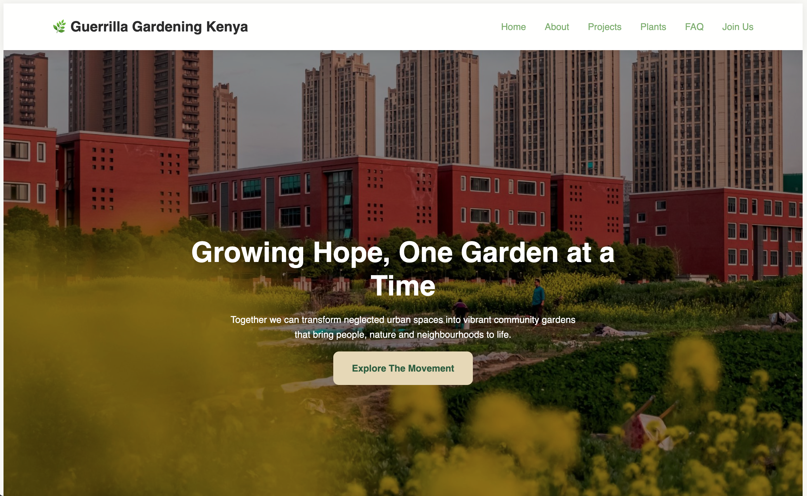

# Guerrilla Gardening Kenya – Growing Greener Communities

A community-focused web project promoting guerrilla gardening, native plants and sustainable urban spaces in Kenya.

**Project status:** In development

## About the Project

Guerrilla Gardening Kenya is a frontend development project exploring the concept of transforming unused and neglected urban spaces into greener, more sustainable environments.

The project aims to raise awareness of community gardening, encourage the use of native plants and inspire individuals to contribute to greener neighbourhoods across Kenya.

The website combines an accessible design approach with responsive layouts and interactive elements to communicate the importance of urban greenery and environmental sustainability.

## Planned Features

- **Home page:** Introduction to guerrilla gardening and its environmental benefits.
- **Community gardening:** Information and inspiration for community-led gardening initiatives.
- **Native plants:** Highlighting the importance of native plants and local biodiversity.
- **Urban greening:** Exploring ways to transform unused urban spaces into green environments.
- **Responsive design:** Layouts optimised for desktop, tablet and mobile devices.
- **Interactive elements:** JavaScript functionality to enhance the user experience.
- **Navigation:** Clear and intuitive navigation throughout the website.

## Technologies

The project is being developed using:

- **HTML5** – Semantic structure and accessible content.
- **CSS3** – Styling, responsive layouts and modern CSS techniques.
- **JavaScript** – Interactive functionality and dynamic user experiences.

## Project Goals

The purpose of this project is to develop and demonstrate practical frontend development skills, including:

- Writing clean and semantic HTML.
- Creating responsive layouts using modern CSS.
- Implementing interactive functionality with JavaScript.
- Improving accessibility and user experience.
- Organising and maintaining a structured frontend project.
- Using Git and GitHub for version control and project management.

## Live Website

Coming soon.

## Developer

**Sidney Roesch**

Frontend Development Student | Aspiring Frontend Developer

GitHub: [@sidneyroesch](https://github.com/sidneyroesch)

---

*Guerrilla Gardening Kenya – Growing greener communities, one space at a time.*
